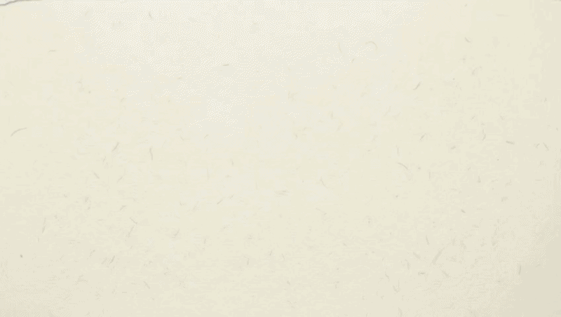
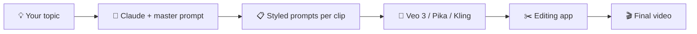

<!-- Put your GIF at assets/demo.gif (or change the path below) -->

# 🎬 Paper Collage Video Prompt Pack ✂️📄

**Turn any topic into handmade paper-collage explainer videos using Claude + Gemini Veo 3.**

---

## ✨ What is this?

A tiny kit with everything you need to make **handmade paper-collage** explainer videos with AI:

✂️ **Torn paper cutouts** · 📜 **Visible paper grain & fibers** · 🖍️ **Hand-drawn doodles & arrows**

Paste one master prompt into Claude, GPT or Gemini, give it a topic, and get ready-to-use video prompts for the tool you choose — with full sound design.

---

## 📂 What's inside

| File | What it is |
| --- | --- |
| 📝 [**paper-collage-master-prompt.md**](paper-collage-master-prompt.md) | The master prompt. Paste it into Claude, GPT or Gemini. It asks for your topic and your video tool, then writes per-clip video prompts. |
| 📖 [**how-to-use-prompt.md**](how-to-use-prompt.md) | Step-by-step guide: questions → outline → per-clip prompts → assembly. |

---

## 🔁 How it works

---

## 🚀 Quick start

1. 📝 Open [`paper-collage-master-prompt.md`](paper-collage-master-prompt.md) and copy the master prompt.
2. 🤖 Paste it into Claude, GPT or Gemini.
3. 💬 Answer six questions: your **topic**, **video tool**, **clips**, **audience**, **voiceover**, and **key points**.
4. ✅ Approve the story outline it plans for you.
5. 📋 Copy the per-clip prompts into your video tool.
6. ✂️ Join the clips in an editing app (CapCut, DaVinci Resolve, Premiere).

Want the full walkthrough? Read [**how-to-use-prompt.md**](how-to-use-prompt.md).

---

## 🎨 The style

| Element | Look |
| --- | --- |
| ✂️ Collage | Torn paper cutouts with white torn edges and soft drop shadows |
| 📜 Texture | Cream paper background with visible grain and fibers, tape strips |
| 🖍️ Doodles | Hand-drawn stars, arrows, circles and handwritten labels |
| 🎞️ Motion | Gentle stop-motion feel at about 8–12 fps |
| 🎨 Palette | Cream `#F6EEDC` · Red `#E03131` · Mustard `#F2B707` · Teal `#2B9691` · Navy `#1B2A4A` · Coral `#FF6B5A` |

---

## 🧰 Works with

| Tool | Output you get |
| --- | --- |
| 🎥 **Gemini Veo 3** | One prompt per 10s clip, ready to stitch |
| 🎞️ **Pika / Kling / Luma** | One prompt per 5s clip |
| 🧠 **Claude / GPT / Gemini** | Story outline, per-clip prompts, sound design, assembly guide |

---

## 💬 Join the community

### Want more AI prompts, templates and dev tips?

### 🌐 Visit our website: [**mughal.dev**](https://mughal.dev)

### 📸 Follow on Instagram: [**@zainmughaldev**](https://instagram.com/zainmughaldev)

---

## ⭐ Support

If this kit helped you, give the repo a **star** ⭐ and share it with someone who makes videos.

Made with ❤️ by **[mughal.dev](https://mughal.dev)**

